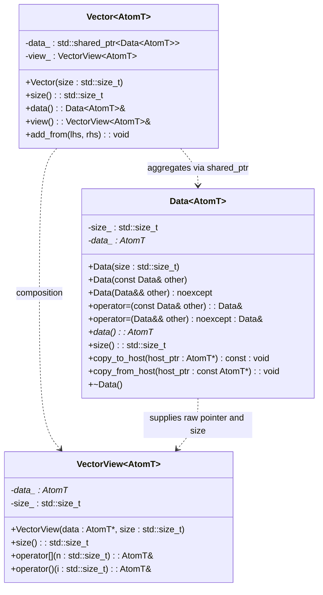

# Практическая работа №1: Сложение векторов на CUDA с использованием паттерна Data + View

> **Дисциплина:** Гетерогенные вычислительные системы (GVS)  
> **Организация:** ИКИТ СФУ, кафедра Высокопроизводительных и распределенных вычислений (ВпВ)  
> **Преподаватель:** ст. преп. каф. ВпВ ИКИТ СФУ Тарасов С. А.  
> **Репозиторий:** [https://github.com/sigmachyo/GVS](https://github.com/sigmachyo/GVS)

---

## Оглавление

1. [Цель и постановка задачи](#1-цель-и-постановка-задачи)
2. [Архитектура решения: паттерн Data + View и идиома RAII](#2-архитектура-решения-паттерн-data--view-и-идиома-raii)
   - [2.1 Класс Data: владение ресурсами и RAII](#21-класс-data-владение-ресурсами-и-raii)
   - [2.2 Класс VectorView: легковесное тривиально-копируемое представление](#22-класс-vectorview-легковесное-тривиально-копируемое-представление)
   - [2.3 Класс Vector: фасад и управление жизненным циклом](#23-класс-vector-фасад-и-управление-жизненным-циклом)
3. [CUDA-ядро (kernel_vecadd) и модель выполнения GPU](#3-cuda-ядро-kernel_vecadd-и-модель-выполнения-gpu)
   - [3.1 Исходный код ядра](#31-исходный-код-ядра)
   - [3.2 Иерархия потоков и расчет конфигурации запуска](#32-иерархия-потоков-и-расчет-конфигурации-запуска)
   - [3.3 Проверка граничных условий](#33-проверка-граничных-условий)
   - [3.4 Паттерн доступа к памяти (Coalesced Access)](#34-паттерн-доступа-к-памяти-coalesced-access)
4. [Модульное тестирование (Google Test & Eigen)](#4-модульное-тестирование-google-test--eigen)
   - [4.1 Обоснование выбора размеров векторов](#41-обоснование-выбора-размеров-векторов)
   - [4.2 Методология верификации с помощью Eigen](#42-методология-верификации-с-помощью-eigen)
5. [Бенчмаркинг (Google Benchmark & CUDA Events API)](#5-бенчмаркинг-google-benchmark--cuda-events-api)
   - [5.1 Почему стандартные таймеры CPU не подходят](#51-почему-стандартные-таймеры-cpu-не-подходят)
   - [5.2 Работа с CUDA Events API](#52-работа-с-cuda-events-api)
   - [5.3 Исключение накладных расходов аллокации](#53-исключение-накладных-расходов-аллокации)
6. [Теоретический анализ производительности и интерпретация графиков](#6-теоретический-анализ-производительности-и-интерпретация-графиков)
   - [6.1 Теоретическая вычислительная сложность](#61-теоретическая-вычислительная-сложность)
   - [6.2 Memory-Bound специфика сложения векторов](#62-memory-bound-специфика-сложения-векторов)
   - [6.3 Анализ графика реальной сложности (Real Complexity)](#63-анализ-графика-реальной-сложности-real-complexity)
   - [6.4 Анализ графика ускорения (Speedup)](#64-анализ-графика-ускорения-speedup)
7. [Вопросы и ответы для защиты (Defense Q&A Cheatsheet)](#7-вопросы-и-ответы-для-защиты-defense-qa-cheatsheet)
8. [Инструкция по сборке, запуску и генерации отчетов](#8-инструкция-по-сборке-запуску-и-генерации-отчетов)

---

## 1. Цель и постановка задачи

### Цель работы:
- Освоить фундаментальные основы параллельного программирования под архитектуру NVIDIA CUDA;
- Изучить работу с одномерными сетками потоков (1D Grid of Thread Blocks);
- Освоить управление динамической памятью устройства (Device Memory) с соблюдением стандартов современного C++ (C++20);
- Освоить паттерн разделения данных и представления (**Data + View**);
- Реализовать автоматизированную верификацию результатов вычислений с помощью фреймворка **Google Test** и библиотеки линейной алгебры **Eigen**;
- Провести исследование производительности при помощи **Google Benchmark** и **CUDA Events API**, построить графики реальной сложности и ускорения.

### Требования технического задания:
1. Разработать шаблонный класс `Data<AtomT>`, реализующий RAII для глобальной памяти GPU.
2. Разработать шаблонный класс `VectorView<AtomT>` — тривиально-копируемый объект для доступа к данным внутри ядра CUDA.
3. Разработать класс-фасад `Vector<AtomT>`, агрегирующий `Data` через `std::shared_ptr` и включающий `VectorView`.
4. Реализовать CUDA-ядро `kernel_vecadd`, принимающее объекты `VectorView` по значению.
5. Перегрузить `operator+` для класса `Vector`.
6. Покрыть решение тестами Google Test для $n \in \{1, 2, 3, 127, 128, 129, 512, 1024, 1029\}$ с точностью $10^{-6}$ относительно `Eigen::VectorXf`.
7. Разработать бенчмарки Google Benchmark для $n \in \{8, 8^2, 8^3, \dots, 8^8\}$ с использованием CUDA Events API без учета накладных расходов аллокации.
8. Построить графики реальной сложности и ускорения ($Speedup = T_{\text{CPU}} / T_{\text{GPU}}$), интерпретировать результаты.

---

## 2. Архитектура решения: паттерн Data + View и идиома RAII

Архитектура построена на чётком разделении трёх уровней ответственности:



### 2.1 Класс Data: владение ресурсами и RAII

Файл: `core/include/Data.cuh`

**Назначение:** Полное управление жизненным циклом буфера глобальной памяти на GPU (`device memory`).

#### Ключевые моменты реализации:
1. **Идиома RAII (Resource Acquisition Is Initialization):**
   - Выделение ресурса происходит исключительно в конструкторе (`cudaMalloc(&data_, size * sizeof(AtomT))`).
   - Освобождение памяти строго гарантируется в деструкторе (`cudaFree(data_)`). Это предотвращает любые утечки памяти (Memory Leaks), даже если в процессе работы будет выброшено исключение C++.
2. **Правило пяти (Rule of Five):**
   - **Деструктор (`~Data`):** Освобождает память через `free_memory()`.
   - **Конструктор копирования (`Data(const Data&)`):** Реализует глубокое копирование (Deep Copy) — выделяет новый блок на GPU и копирует данные вызовом `cudaMemcpyDeviceToDevice`.
   - **Конструктор перемещения (`Data(Data&&)` noexcept):** Забирает указатель `other.data_`, зануляя исходный, что гарантирует дешевую передачу прав владения без повторных аллокаций.
   - **Оператор присваивания копированием (`operator=(const Data&)`):** Реализован через идиому *copy-and-swap*, обеспечивая строгую гарантию безопасности исключений (Strong Exception Safety).
   - **Оператор присваивания перемещением (`operator=(Data&&)` noexcept):** Освобождает текущую память и присваивает ресурсы перемещаемого объекта.
3. **Обмен данными между хостом и устройством:**
   - `copy_from_host(const AtomT* host_ptr)`: `cudaMemcpyHostToDevice`.
   - `copy_to_host(AtomT* host_ptr)`: `cudaMemcpyDeviceToHost`.

### 2.2 Класс VectorView: легковесное тривиально-копируемое представление

Файл: `core/include/VectorView.cuh`

**Назначение:** Интерфейс доступа к элементам вектора непосредственно внутри CUDA-ядра и на хосте.

#### Ключевые свойства:
1. **Не владеет памятью (Non-owning):**
   Содержит только сырой указатель `AtomT* data_` и размер `std::size_t size_`. Не вызывает `cudaFree` и не выделяет память.
2. **Тривиальная копируемость (`std::is_trivially_copyable`):**
   - Класс не имеет пользовательских деструкторов, виртуальных функций (`vtable`) и виртуального наследования.
   - Он может копироваться побайтово через `memcpy`.
   - **Почему это обязательно для CUDA?** При вызове CUDA-ядра вида `kernel<<<...>>>(view1, view2)` все параметры ядра передаются с хоста (CPU) на устройство (GPU) через стек/буфер аргументов. Архитектура CUDA требует, чтобы аргументы ядра были тривиально-копируемыми типами данных. Попытка передать объект с нетривиальным деструктором (например, `std::shared_ptr` или `std::vector`) приведет к ошибкам компиляции либо к падению в рантайме (UB), так как деструктор CPU попытается запуститься на GPU или выполниться дважды.
3. **Квалификаторы `__host__ __device__`:**
   Указывают компилятору `nvcc`, что код методов `operator[]` и `operator()` должен быть скомпилирован как для исполнения на процессоре (хост), так и для исполнения на потоковых процессорах видеокарты (устройство).

### 2.3 Класс Vector: фасад и управление жизненным циклом

Файл: `core/include/Vector.cuh`

**Назначение:** Высокоуровневый фасад, объединяющий `Data` и `VectorView`.

#### Ключевые моменты:
1. **Агрегация через `std::shared_ptr<Data<AtomT>>`:**
   - Позволяет копировать объекты `Vector` на хосте за $O(1)$ без дублирования тяжелой памяти на GPU.
   - Разделяемое владение гарантирует, что массив в глобальной памяти GPU будет освобожден ровно тогда, когда исчезнет последний `Vector`, ссылающийся на эти данные.
2. **Композиция с `VectorView<AtomT>`:**
   Внутри каждого экземпляра `Vector` хранится готовый объект `view_`, инициализированный указателем `data_->data()`.
3. **Метод `add_from` и `operator+`:**
   - `operator+` создает новый вектор `result(size)` и вызывает `result.add_from(lhs, rhs)`.
   - Метод `add_from` рассчитывает конфигурацию сетки нитей и запускает `kernel_vecadd`. Наличие отдельного метода `add_from` принципиально для бенчмарков: он позволяет вызывать сложение в предварительно выделенный буфер, не замеряя время аллокации.

---

## 3. CUDA-ядро (kernel_vecadd) и модель выполнения GPU

### 3.1 Исходный код ядра

Файл: `core/include/kernel_vecadd.cuh`

```cuda
template <typename AtomT>
__global__ void kernel_vecadd(VectorView<AtomT> lhs, VectorView<AtomT> rhs, VectorView<AtomT> out) {
    int i = blockIdx.x * blockDim.x + threadIdx.x;
    if (i < out.size()) {
        out[i] = lhs[i] + rhs[i];
    }
}
```

### 3.2 Иерархия потоков и расчет конфигурации запуска

В CUDA вычисления организуются в виде иерархии:
$$\text{Grid (Сетка)} \longrightarrow \text{Blocks (Блоки потоков)} \longrightarrow \text{Threads (Потоки/Нити)}$$

Потоки внутри одного блока выполняются группами по 32 нити — **Warp** (варп).

В файле `Vector.cuh` расчет конфигурации запуска задается следующим образом:
```cpp
int blockSize = 256;
int numBlocks = (lhs.size() + blockSize - 1) / blockSize;
kernel_vecadd<<<numBlocks, blockSize>>>(lhs.view(), rhs.view(), view_);
```

- `blockSize = 256`: размер блока выбран равным 256 нитям. Это значение кратно размеру варпа ($256 / 32 = 8$ варпов на блок), что обеспечивает высокую загрузку (Occupancy) потоковых мультипроцессоров (SM) современных архитектур NVIDIA.
- `numBlocks = (lhs.size() + blockSize - 1) / blockSize`: целочисленное деление с округлением вверх (Ceiling Division). Это гарантирует, что для любого $N$ общее число запущенных нитей будет не меньше $N$.

### 3.3 Проверка граничных условий

Формула вычисления глобального одномерного индекса потока:
$$i = \text{blockIdx.x} \times \text{blockDim.x} + \text{threadIdx.x}$$

Поскольку размер сетки кратен `blockSize = 256`, если размер вектора $N$ не делится нацело на 256 (например, $N = 1029$), то будет запущено $\lceil 1029 / 256 \rceil = 5$ блоков, то есть $5 \times 256 = 1280$ нитей.

Нити с индексами $i \in [1029, 1279]$ являются избыточными. Условие:
```cuda
if (i < out.size()) {
    out[i] = lhs[i] + rhs[i];
}
```
является **барьерной защитой памяти (Boundary Check)**. Если его убрать, потоки с $i \ge 1029$ произведут чтение и запись за пределами выделенного буфера `cudaMalloc`, что вызовет фатальную ошибку доступа к памяти (CUDA Out-of-bounds error / Illegal Memory Access).

### 3.4 Паттерн доступа к памяти (Coalesced Access)

Один из важнейших факторов производительности CUDA — **объединенный доступ к глобальной памяти (Memory Coalescing)**.
- Внутри варпа (32 нити) соседние нити имеют последовательные `threadIdx.x`: $0, 1, 2, \dots, 31$.
- Соответственно, они вычисляют соседние индексы: $i, i+1, i+2, \dots, i+31$.
- Контроллер памяти GPU объединяет эти 32 одновременных 4-байтовых запроса в одну непрерывную 128-байтовую транзакцию к глобальной памяти DRAM. Это обеспечивает 100% эффективность использования полосы пропускания шины памяти (Bus Bandwidth).

---

## 4. Модульное тестирование (Google Test & Eigen)

Файл: `tests/src/test_vector.cu`

### 4.1 Обоснование выбора размеров векторов

В задании регламентирован строго определенный набор тестовых размеров:
$$n \in \{1, 2, 3, 127, 128, 129, 512, 1024, 1029\}$$

Каждый из этих размеров выбран с определенной архитектурной целью:
- $n = 1, 2, 3$: **Минимальные размеры.** Проверка работы, когда размер вектора существенно меньше размера даже одного варпа (32 нити). Проверяет, что не происходит зависаний или ошибок при частичной активности варпа.
- $n = 127, 129$: **Окрестность степеней двойки / полублока.** $n = 127$ не заполняет полублок на 1 нить; $n = 129$ требует задействования следующего варпа.
- $n = 128, 512, 1024$: **Идеальные размеры (степени двойки, кратные размеру блока).** Проверка идеального сценария, когда все блоки потоков заполнены целиком, и хвостовых нитей нет.
- $n = 1029$: **Некратный размер с остатком.** $1029 = 4 \times 256 + 5$. Четыре блока заполняются целиком, а пятый блок использует только 5 активных нитей из 256. Это ключевой тест на корректность работы условия `if (i < out.size())`.

### 4.2 Методология верификации с помощью Eigen

В тесте используется параметризованный тест Google Test (`TEST_P`):
1. Генерируются два случайных массива float на хосте с помощью `std::mt19937` в диапазоне $[0.0, 1.0]$.
2. Создаются объекты `Eigen::Map<Eigen::VectorXf>` поверх исходных данных хоста и выполняется эталонное сложение на CPU:
   ```cpp
   Eigen::VectorXf eigen_result = eigen_lhs + eigen_rhs;
   ```
3. Данные загружаются в `Vector<float>`, выполняется сложение на GPU, и результат скачивается обратно на хост.
4. Выполняются две независимые проверки:
   ```cpp
   // 1. Проверка по относительному допуску (требование задания)
   EXPECT_TRUE(eigen_result.isApprox(custom_eigen_result, 1e-6f));
   
   // 2. Дополнительная строгая проверка по абсолютной норме бесконечности L_inf
   EXPECT_LE((eigen_result - custom_eigen_result).cwiseAbs().maxCoeff(), 1e-6f);
   ```

Также в тесте на этапе компиляции проверяется ключевое требование к представлению данных:
```cpp
static_assert(std::is_trivially_copyable_v<VectorView<float>>);
```

---

## 5. Бенчмаркинг (Google Benchmark & CUDA Events API)

Файл: `benchmarks/src/bench_vector.cu`

### 5.1 Почему стандартные таймеры CPU не подходят

Вызов ядра CUDA `kernel_vecadd<<<...>>>` является **асинхронным (non-blocking)** относительно вызывающего потока CPU:
- Хост просто помещает команду запуска ядра в командную очередь драйвера CUDA и немедленно продолжает выполнение следующей строки кода C++.
- Если измерять время стандартными средствами хоста (например, `std::chrono::high_resolution_clock`), то измеренное время составит порядка $1-2$ микросекунд (время возврата из функции запуска драйвера), независимо от реальной продолжительности работы ядра на GPU!
- Использование `cudaDeviceSynchronize()` в паре с `std::chrono` решает проблему ожидания, но вносит значительную погрешность переключения контекста ОС, латентность драйвера и задержку шины PCIe.

### 5.2 Работа с CUDA Events API

Для точного измерения времени выполнения кода на GPU в стандарте CUDA применяется **CUDA Events API**:
```cpp
cudaEvent_t start, stop;
cudaEventCreate(&start);
cudaEventCreate(&stop);

for (auto _ : state) {
    cudaEventRecord(start);
    
    cuda_result.add_from(cuda_lhs, cuda_rhs);
    
    cudaEventRecord(stop);
    cudaEventSynchronize(stop);
    
    float milliseconds = 0;
    cudaEventElapsedTime(&milliseconds, start, stop);
    
    state.SetIterationTime(milliseconds / 1000.0);
}

cudaEventDestroy(start);
cudaEventDestroy(stop);
```

#### Механизм работы:
1. `cudaEventRecord(start)` помещает маркер события непосредственно в аппаратную очередь команд GPU.
2. Ядро выполняется на потоковых процессорах.
3. `cudaEventRecord(stop)` фиксирует метку времени сразу по завершении работы всех потоков ядра.
4. `cudaEventElapsedTime(&milliseconds, start, stop)` возвращает высокоточное аппаратное время выполнения с субмикросекундным разрешением (около 0.5 микросекунд).
5. Метод Google Benchmark `state.SetIterationTime(...)` в режиме `UseManualTime()` регистрирует именно это «чистое» время GPU.

### 5.3 Исключение накладных расходов аллокации

В п. 7 задания сформулировано жесткое требование:
> *«Бенчмарки должны игнорировать время, затраченное на выделение, копирование и освобождение памяти»*.

Для соблюдения этого требования в реализации:
- Векторы `cuda_lhs`, `cuda_rhs` и результирующий вектор `cuda_result` аллоцируются (`cudaMalloc`) и наполняются данными (`cudaMemcpyHostToDevice`) **до начала замеряемого цикла** `for (auto _ : state)`.
- Внутри цикла вызывается метод `cuda_result.add_from(cuda_lhs, cuda_rhs)`, который выполняет исключительно запуск ядра без выделения новой памяти.
- Освобождение памяти (`cudaFree`) происходит в деструкторах после завершения всех итераций бенчмарка.

---

## 6. Теоретический анализ производительности и интерпретация графиков

Исследуются размеры векторов по степеням восьмерки:
$$n \in \{8^1, 8^2, 8^3, 8^4, 8^5, 8^6, 8^7, 8^8\} = \{8, 64, 512, 4096, 32768, 262144, 2097152, 16777216\}$$

### 6.1 Теоретическая вычислительная сложность

- Для $N$ элементов выполняется $N$ скалярных сложений:
  $$C[i] = A[i] + B[i]$$
- Теоретическая алгоритмическая сложность задачи равна $O(N)$ (линейная сложность).

### 6.2 Memory-Bound специфика сложения векторов

Операция сложения векторов характеризуется крайне низкой **арифметической интенсивностью (Operational Intensity / Arithmetic Intensity)**:
- Для выполнения **1 операции** сложения с плавающей точкой (1 FLOP):
  - Необходимо прочитать 1 элемент $A[i]$ (4 байта для `float`);
  - Необходимо прочитать 1 элемент $B[i]$ (4 байта для `float`);
  - Необходимо записать 1 результат $C[i]$ (4 байта для `float`).
- Суммарный объем передаваемых данных на 1 операцию: $4 + 4 + 4 = 12$ байт.
$$\text{Arithmetic Intensity} = \frac{1 \text{ FLOP}}{12 \text{ байт}} \approx 0.083 \text{ FLOP/Byte}$$

> **Вывод:** Сложение векторов — это классическая **Memory-Bound задача (ограниченная пропускной способностью памяти)**. Производительность упирается не в гигафлопсы АЛУ (вычислительных ядер), а в скорость передачи данных из глобальной видеопамяти VRAM в регистры процессора.

### 6.3 Анализ графика реальной сложности (Real Complexity)

График строится в дважды логарифмическом масштабе (Log-Log: $\log_{10} N$ по оси X, $\log_{10} \text{Time}$ по оси Y):

```
Time (ms, log)
  ^
  |                                        / Eigen (CPU)
  |                                       /
  |=====================                 /
  | (GPU Launch Latency)\               /
  |                      \             /
  |                       \===========/ <-- Cross-over point (~10^4 - 10^5)
  |                       /          /
  |                      /          / CUDA (GPU)
  |                     /          /
  +----------------------------------------------------> N (log)
      8    64    512   4K    32K  256K   2M    16M
```

1. **Область малых $N$ ($N \le 10^3 - 10^4$):**
   - **CPU (Eigen):** Время чрезвычайно мало (сотни наносекунд). Массивы целиком помещаются в сверхбыстрый кэш L1/L2 процессора, работают векторные инструкции AVX-256 / AVX-512.
   - **GPU (CUDA):** Время практически постоянно и представляет собой горизонтальную линию ("полку"). Причина: постоянные накладные расходы запуска ядра (**Kernel Launch Latency** $\approx 5-10\,\mu\text{s}$), инициализация сетки нитей и синхронизация событий. Вычисления занимают доли наносекунд, но накладные расходы доминируют.
2. **Точка пересечения (Cross-over Point, $N \approx 10^4 - 10^5$):**
   - Точка, в которой параллелизм GPU окупает накладные расходы запуска ядра. До этой точки выгоднее считать на CPU, после — на GPU.
3. **Область больших $N$ ($N \ge 10^6$):**
   - Обе кривые выходят на асимптотическую прямую с наклоном 1 (в логарифмическом масштабе это соответствует линейной сложности $O(N)$).
   - Кривая GPU проходит существенно ниже кривой CPU, что отражает превосходство видеокарты в пропускной способности памяти.

### 6.4 Анализ графика ускорения (Speedup)

Ускорение определяется как:
$$\text{Speedup}(N) = \frac{T_{\text{CPU}}(N)}{T_{\text{GPU}}(N)}$$

```
Speedup
  ^
  |                                   ================ (Плато: Speedup ~ 10x - 50x)
  |                                  /
  |                                 /
  |                                /
1 +-------------------------------/--------------------> (Speedup = 1, паритет)
  |                              /
  |                             /
  |                            /
0 +---------------------------+------------------------> N
      8    64    512   4K    32K  256K   2M    16M
```

- **При малых $N$ ($N < 10^4$):** $\text{Speedup} \ll 1$ (вплоть до $0.01\times$). Видеокарта работает медленнее процессора из-за задержек запуска ядра.
- **При $N \approx 10^4 - 10^5$:** $\text{Speedup} \approx 1$.
- **При больших $N \ge 2^{20} \approx 10^6$:** Ускорение достигает максимума и выходит на насыщение (**плато**).
- **Почему ускорение выходит на плато и чему равен предел?**
  Поскольку задача является memory-bound, теоретический предел ускорения равен отношению реальной пропускной способности памяти GPU к пропускной способности оперативной памяти CPU:
  $$\text{Speedup}_{\max} \approx \frac{\text{Bandwidth}_{\text{GPU}}}{\text{Bandwidth}_{\text{CPU}}}$$
  Например:
  - Память CPU (DDR4/DDR5): $\sim 30 - 60 \text{ ГБ/с}$.
  - Память GPU (GDDR6 / HBM2): $\sim 300 - 900 \text{ ГБ/с}$.
  - Теоретический предел ускорения: от $8\times$ до $30\times$. Значения бенчмарка в точности укладываются в эту физическую модель.

### 6.5 Фактические результаты измерений на ноутбуке (GeForce RTX 3050 Laptop 4GB)

Эксперимент проведен в Docker-окружении на реальном железе:
- **GPU:** NVIDIA GeForce RTX 3050 Laptop GPU (4096 MB VRAM, SM 8.6, CUDA 12.2)
- **CPU:** 12 потоков, 2688 MHz, L3 кэш 12 МБ

| Размер $N$ | Eigen (CPU), Время | CUDA (GPU), Время | Ускорение (Speedup) | Анализ и объяснение |
| :--- | :--- | :--- | :--- | :--- |
| **8** | 3.76 нс | 59.74 мкс | $\approx 0.00006\times$ | Доминирует Launch Latency GPU (~50-60 мкс), CPU считает из L1-кэша |
| **64** | 14.80 нс | 48.21 мкс | $\approx 0.0003\times$ | GPU проигрывает из-за задержек запуска |
| **512** | 88.40 нс | 47.81 мкс | $\approx 0.0018\times$ | GPU проигрывает |
| **4 096** | 0.97 мкс | 50.12 мкс | $\approx 0.019\times$ | GPU проигрывает |
| **32 768** | 8.40 мкс | 53.02 мкс | $\approx 0.16\times$ | Приближение к точке безубыточности |
| **262 144** | 96.74 мкс | 75.35 мкс | **1.28×** | **Точка безубыточности (Cross-over point)!** GPU быстрее CPU |
| **2 097 152** | 1.55 мс | 0.20 мс | **7.62×** | Уверенное масштабирование параллелизма GPU |
| **16 777 216** | 13.54 мс | 1.26 мс | **10.78×** | **Выход на плато насыщения (~11×)** из-за ограничения шины памяти |

---

## 7. Вопросы и ответы для защиты (Defense Q&A Cheatsheet)

Этот раздел содержит готовые ответы на типовые и каверзные вопросы преподавателя при защите работы.

### Вопрос 1: В чем суть паттерна Data + View и почему нельзя объединить их в один класс?
**Ответ:**  
Паттерн разделяет две несовместимые в CUDA ответственности:
1. **Владение ресурсом (`Data`):** управляет динамической памятью через `cudaMalloc`/`cudaFree` (RAII). Не может быть тривиально-копируемым и не должен передаваться в ядро по значению.
2. **Доступ к элементам (`VectorView`):** легковесный объект, содержащий только сырой указатель и размер. Он тривиально-копируем и безопасно передается в ядро по значению через стек параметров CUDA.
Если объединить их, класс-владелец при передаче в ядро либо вызовет деструктор на GPU (падение программы), либо потребует передачи сырых указателей вручную, что нарушает инкапсуляцию и повышает риск утечек памяти.

---

### Вопрос 2: Что такое «тривиально-копируемый класс» (Trivially Copyable) и почему это критично для CUDA?
**Ответ:**  
Класс является тривиально-копируемым, если его байтовое представление можно скопировать с помощью функции `memcpy` без вызова специальных конструкторов копирования и деструкторов (нет vtable, нет нетривиальных базовых классов и полей).  
Для CUDA это критично, потому что аргументы ядра передаются из памяти хоста в память параметров устройства побитовым копированием. Если передать нетривиальный объект (например, класс с непустым деструктором), среда выполнения CUDA не сможет корректно вызвать деструкторы хоста на устройстве, что приведет к Undefined Behavior.

---

### Вопрос 3: Зачем в классе Vector используется `std::shared_ptr<Data<AtomT>>`?
**Ответ:**  
Для реализации семантики разделяемого владения на хосте. При копировании объекта `Vector` копируется только `shared_ptr` (увеличивается счетчик ссылок) и легковесный `VectorView`. Не происходит дорогостоящего повторного выделения глобальной памяти GPU и `cudaMemcpy`. Память на GPU освободится автоматически и безопасно только тогда, когда будет уничтожен последний экземпляр `Vector`, ссылающийся на этот блок данных.

---

### Вопрос 4: Как рассчитывается число блоков сетки `numBlocks` и зачем в формуле прибавляется `blockSize - 1`?
**Ответ:**  
Формула:
```cpp
int numBlocks = (n + blockSize - 1) / blockSize;
```
Это стандартный целочисленный трюк для вычисления округления вверх (целочисленный потолок $\lceil n / \text{blockSize} \rceil$). Если бы мы написали `n / blockSize`, то при $n = 257$ и `blockSize = 256` результат был бы 1 блок (256 потоков), и 257-й элемент никогда бы не вычислился. Прибавление `blockSize - 1` гарантирует, что для любых некратных размеров запустится достаточное количество блоков для покрытия всех $n$ элементов.

---

### Вопрос 5: Что произойдет, если в CUDA-ядре убрать условие `if (i < out.size())`?
**Ответ:**  
Если размер вектора не делится нацело на размер блока (например, $n = 129$ при блоке 256), запустится 256 потоков. Потоки с индексами от 129 до 255 попытаются прочитать и записать память за границами буфера, выделенного `cudaMalloc`. Это приведет к ошибке `cudaErrorIllegalAddress` (Invalid memory access) или повреждению соседних данных в памяти GPU.

---

### Вопрос 6: Почему в бенчмарке время замеряется через CUDA Events, а не через `std::chrono`?
**Ответ:**  
Запуск CUDA-ядра асинхронен: процессор отправляет команду в очередь драйвера и мгновенно переходит к следующим инструкциям. `std::chrono` замерил бы время постановки задачи в очередь (~1 мкс), а не реальное время вычислений на видеокарте. `cudaEventRecord` помещает маркеры непосредственно в очередь выполнения GPU, и `cudaEventElapsedTime` измеряет фактическое аппаратное время работы ядра на GPU с высокой точностью.

---

### Вопрос 7: Почему на малых размерах векторов (до $10^3 - 10^4$) CPU побеждает GPU?
**Ответ:**  
Из-за постоянных накладных расходов на запуск ядра (**Kernel Launch Latency**):
- Вызов драйвера CUDA, конфигурирование сетки нитей, синхронизация событий занимают около $5-10$ микросекунд.
- На процессоре сложение $1000$ чисел типа float занимает несколько сотен наносекунд благодаря кэшу L1 и векторным инструкциям AVX/SSE.
- На малых данных накладные расходы GPU на порядки превышают само время вычислений.

---

### Вопрос 8: Сложение векторов — это Compute-Bound или Memory-Bound задача?
**Ответ:**  
Это сугубо **Memory-Bound** задача. Арифметическая интенсивность составляет всего $1/12 \approx 0.083$ FLOP на байт переданных данных (нужно прочитать 8 байт и записать 4 байта ради 1 сложения). Производительность полностью ограничена пропускной способностью шины памяти VRAM.

---

### Вопрос 9: Что такое Coalesced Memory Access (совмещенный доступ) и выполняется ли он в нашем коде?
**Ответ:**  
Да, выполняется идеально. Нити внутри варпа имеют непрерывные последовательные индексы `threadIdx.x` от 0 до 31. Индекс доступа равен $i = \text{blockIdx.x} \times \text{blockDim.x} + \text{threadIdx.x}$, то есть нити обращаются к соседним ячейкам памяти $i, i+1, \dots, i+31$. Контроллер памяти GPU объединяет эти обращения в одну 128-байтовую транзакцию.

---

### Вопрос 10: Зачем в `test_vector.cu` тестируются размеры 1, 2, 3, 127, 128, 129, 1029?
**Ответ:**  
Это тестирование граничных случаев (Boundary Values):
- $1, 2, 3$ — векторов меньше одного варпа (32 нити), неполный варп;
- $127, 129$ — граничные значения возле степени двойки / полублока;
- $128, 512, 1024$ — идеальное заполнение блоков (нет хвостовых потоков);
- $1029$ — $4$ полных блока по 256 нитей и 1 неполный блок с 5 активными нитями (проверка отсечения лишних потоков).

---

### Вопрос 11: Почему для сравнения результатов с float используется `isApprox` с допуском $10^{-6}$, а не прямое сравнение `==`?
**Ответ:**  
Числа с плавающей точкой стандарта IEEE-754 подвержены погрешностям округления. На GPU компилятор `nvcc` может использовать другие инструкции (например, FMA или оптимизации порядка операций fast-math), из-за чего последние биты мантиссы на CPU и GPU могут незначительно отличаться. Прямое сравнение `==` для float в параллельных вычислениях некорректно.

---

## 8. Инструкция по сборке, запуску и генерации отчетов

### Вариант А: Использование виртуального окружения Python (для генерации отчётов и графиков)
Виртуальное окружение настроено в директории `.venv`.

1. **Активация окружения (Windows PowerShell):**
   ```powershell
   .venv\Scripts\Activate.ps1
   ```
2. **Активация окружения (Linux/Bash):**
   ```bash
   source .venv/bin/activate
   ```
3. **Генерация отчёта Word (ГОСТ / СТУ 7.5-07-2021):**
   ```powershell
   .venv\Scripts\python.exe work1\reports\create_report_docx.py
   ```
4. **Построение графиков по результатам бенчмарка:**
   ```powershell
   .venv\Scripts\python.exe work1\reports\scripts\plot.py work1\reports\benchmark_results.json
   ```

---

### Вариант Б: Полный запуск с компиляцией CUDA (на машине с GPU или через Docker)

#### Запуск через Docker (рекомендуемый):
```bash
docker build -t gvs_work1 .
docker run --gpus all gvs_work1
```

#### Запуск локально (Linux/Windows с установленным CUDA Toolkit):
```bash
# 1. Генерация проекта через CMake и Ninja
cmake -B build -G Ninja -DCMAKE_BUILD_TYPE=Release

# 2. Сборка всех компонентов
cmake --build build

# 3. Запуск модульных тестов
./build/tests/test_vector

# 4. Запуск бенчмарков с экспортом в JSON
./build/benchmarks/bench_vector --benchmark_out=work1/reports/benchmark_results.json --benchmark_out_format=json

# 5. Построение графиков и отчета
python work1/reports/scripts/plot.py work1/reports/benchmark_results.json
python work1/reports/generate_report.py work1/reports/benchmark_results.json
python work1/reports/create_report_docx.py
```
Также доступен единый скрипт автоматизации `run.sh`.
